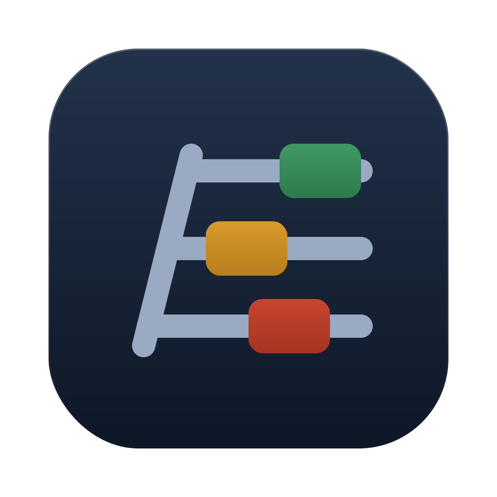
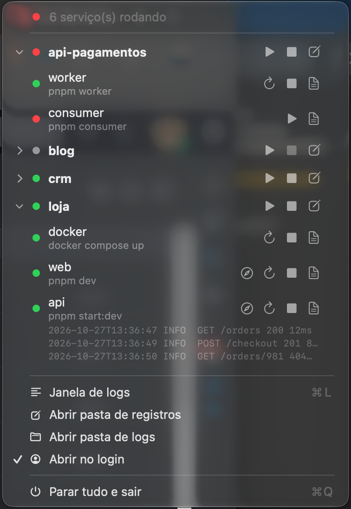
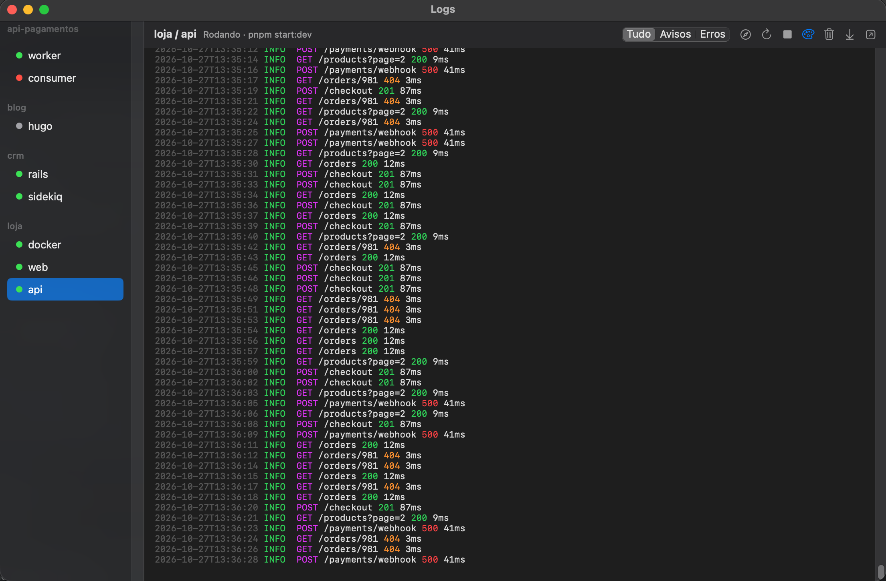

<p align="center">
  
</p>

<h1 align="center">Runyard</h1>

<p align="center">
  Os servidores locais de todos os seus projetos, na barra de menu do macOS.
</p>

<p align="center">
  
  
  
</p>

<p align="center">
  
</p>

Cada projeto tem vários processos: banco no Docker, front, back, worker. O Runyard sobe, para e acompanha todos eles a partir de um menu. Ele também tem uma CLI, para você ou um agente de IA controlar os mesmos serviços pelo terminal.

## Funcionalidades

- **Um clique por serviço ou por projeto.** Suba, pare ou reinicie um serviço ou o projeto inteiro direto no menu.
- **Status em tempo real.** Cada serviço mostra se está rodando, parado ou se encerrou com erro. O ícone mostra quantos serviços estão rodando.
- **Fim do log no menu.** Abra as últimas linhas do log de um serviço sem sair do menu.
- **Botão de abrir no navegador.** O app acha a URL local no log (por exemplo `http://localhost:5173`) e mostra um botão para abrir.
- **Janela de logs.** Acompanhe o log de cada serviço com cores, busca e filtro por nível.
- **Aviso de queda.** O app manda uma notificação quando um serviço encerra com erro, com os botões "Reiniciar" e "Ver log".
- **Reinício automático.** Com `restart: true`, o app sobe o serviço de novo depois de uma queda.
- **Porta ocupada.** Antes de subir um serviço, o app confere a porta e oferece encerrar o processo que a usa.
- **CLI `runyard`.** Controle tudo pelo terminal. A CLI sai com código 1 se algum serviço não ficou rodando.
- **Abrir no login.** Ligue a opção no menu e o app abre junto com o macOS.

## Instalação

Requisitos: macOS 14 ou mais novo e as ferramentas de linha de comando do Xcode (`xcode-select --install`).

```sh
git clone https://github.com/AlexSzefezuk/runyard.git
cd runyard
./build.sh --install
```

O `build.sh --install` faz quatro coisas:

1. Compila o app em modo release.
2. Copia o `Runyard.app` para `~/Applications`.
3. Cria o link `~/.local/bin/runyard` para a CLI.
4. Abre o app.

Confirme que `~/.local/bin` está no seu `PATH` para usar a CLI.

## Registro de projetos

Cada projeto tem um arquivo em `~/.config/runyard/projects/<projeto>.json`:

```json
{
  "name": "loja",
  "path": "~/projects/loja",
  "services": [
    { "name": "docker", "command": "docker compose up" },
    { "name": "web", "command": "pnpm dev", "path": "frontend", "restart": true },
    { "name": "api", "command": "pnpm start:dev", "path": "backend", "url": "http://localhost:3000" },
    { "name": "worker", "command": "pnpm worker", "path": "backend", "env": { "QUEUE": "emails" } }
  ]
}
```

| Campo | Onde | Obrigatório | O que faz |
| --- | --- | --- | --- |
| `name` | projeto | não | Nome no menu e na CLI. O padrão é o nome do arquivo. |
| `path` | projeto | sim | Pasta do projeto. Aceita `~`. |
| `services` | projeto | sim | Lista de serviços. |
| `name` | serviço | sim | Nome do serviço. |
| `command` | serviço | sim | Comando. O app roda com `zsh -l` dentro da pasta do serviço. |
| `path` | serviço | não | Pasta própria, absoluta ou relativa ao `path` do projeto. Use isso quando um projeto tem vários repositórios. |
| `env` | serviço | não | Variáveis de ambiente extras. |
| `url` | serviço | não | URL do botão de abrir no navegador. Sem ele, o app usa a primeira URL local do log da execução atual. |
| `port` | serviço | não | Porta que o app confere antes de subir. Sem ele, o app usa `env.PORT`, a porta de `url` ou a porta da URL achada no log da última execução. |
| `restart` | serviço | não | `true` sobe o serviço de novo 2 segundos depois de uma queda. O app desiste depois de 5 quedas em 1 minuto. |

Regras:

- Um serviço é um processo. Não use `&` nem `concurrently` no `command`.
- O app relê os registros toda vez que o menu abre. Não precisa reiniciar o app.
- Se um registro tem erro, o menu mostra o arquivo e o campo com problema.
- No menu, "Abrir pasta de registros" abre `~/.config/runyard/projects`.

## Menu

Clique no nome de um projeto para abrir a lista de serviços. Cada linha de serviço mostra:

- O status: rodando, parando, parado ou encerrado com código.
- Os botões de subir, parar e reiniciar.
- O botão de abrir no navegador, quando o app conhece a URL.
- O botão de ver log, que abre as últimas linhas do log ali mesmo.

O cabeçalho de cada projeto tem os botões "Subir todos", "Parar todos" e "Editar registro". "Parar tudo e sair" (⌘Q) para todos os serviços antes de fechar o app.

## Janela de logs

<p align="center">
  
</p>

Abra a janela pelo menu com ⌘L. Ela acompanha o log de cada serviço e tem:

- Busca com ⌘F, ⌘G e ⇧⌘G.
- Filtro por nível: tudo, avisos ou erros.
- Formatador que mostra as cores do comando e destaca níveis, códigos HTTP, URLs e linhas JSON.
- Botões para subir, parar, reiniciar, limpar a tela, ir para o fim e abrir o log no Console.

O app exporta `FORCE_COLOR=1` e `CLICOLOR_FORCE=1` para os comandos gerarem cor.

## Avisos

- Quando um serviço encerra com erro, o app manda uma notificação com os botões "Reiniciar" e "Ver log".
- Antes de subir um serviço pelo menu, o app confere se a porta está livre. Se a porta está ocupada, ele mostra o processo dono e oferece três opções: "Encerrar e subir", "Subir mesmo assim" ou "Cancelar".
- Pela CLI, o app não pergunta. Ele só grava um aviso de porta ocupada no log.

## CLI

A CLI fala com o app por um socket local. Se o app está fechado, a CLI abre o app.

```sh
runyard status [projeto]
runyard start <projeto> [serviço...]
runyard stop <projeto> [serviço...]
runyard restart <projeto> [serviço...]
runyard logs <projeto> <serviço> [-n linhas] [-f] [--path]
```

Sem serviço, `start`, `stop` e `restart` agem em todos os serviços do projeto.

```text
$ runyard start api-pagamentos
api-pagamentos
  worker    rodando     pid 83684
  consumer  erro (código 1)
Algum serviço não ficou rodando. Veja com: runyard logs api-pagamentos <serviço>

$ runyard status loja
loja
  docker    rodando     pid 83031
  web       rodando     pid 83034
  api       rodando     pid 83051
```

`runyard logs` mostra o fim do log. `--path` mostra só o caminho do arquivo. `-f` acompanha o log sem terminar. A CLI tira as cores quando a saída não é um terminal.

### Uso com agentes de IA

O código de saída e a saída curta da CLI servem bem para agentes como o Claude Code. Um agente pode subir o projeto, ver se tudo ficou rodando e ler o fim do log quando algo falha. Coloque instruções como estas no `CLAUDE.md` ou `AGENTS.md`:

```markdown
- Use `runyard status|start|stop|restart` para controlar os servidores locais.
- Se a CLI sair com código 1, leia o log com `runyard logs <projeto> <serviço> -n 200`.
- Nunca use `runyard logs -f`. Ele não termina.
```

## Arquivos

| Caminho | Conteúdo |
| --- | --- |
| `~/.config/runyard/projects/*.json` | Registros dos projetos |
| `~/Library/Logs/runyard/<projeto>/<serviço>.log` | Log de cada serviço |
| `~/.config/runyard/runyard.sock` | Socket entre a CLI e o app |

## Desenvolvimento

```sh
swift build
./build.sh
```

O `./build.sh` sem `--install` só gera `build/Runyard.app`. O código tem três alvos:

- `RunyardCore`: registros, socket de controle e leitura de log.
- `Runyard`: o app de barra de menu.
- `RunyardCLI`: a CLI `runyard`.

## Licença

[MIT](LICENSE)
